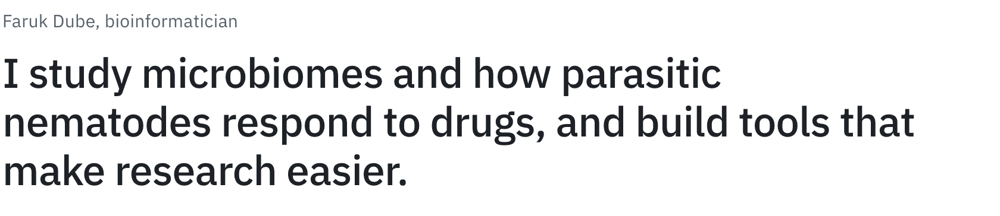
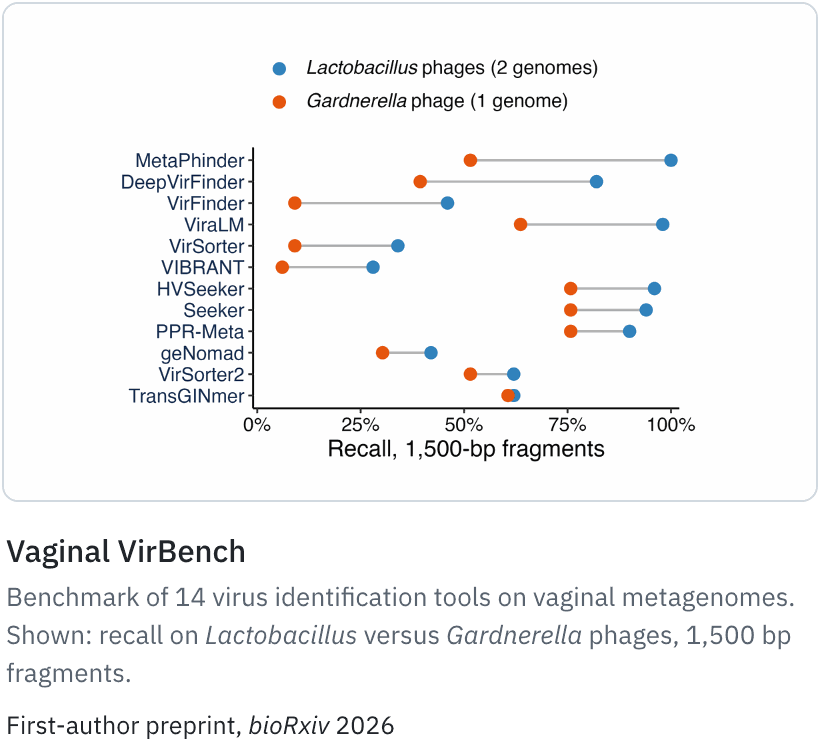
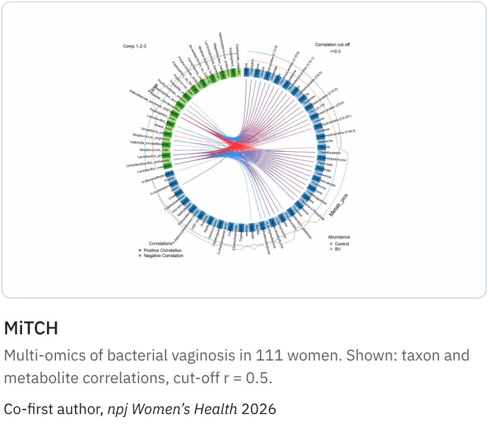
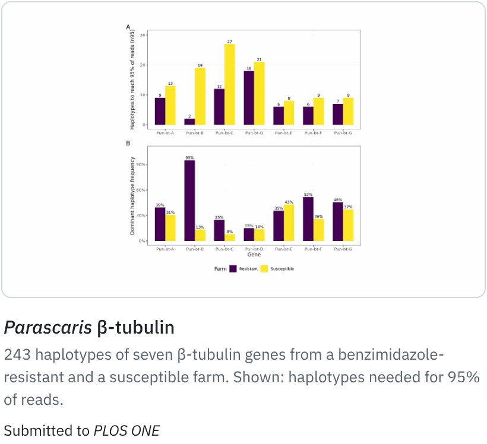
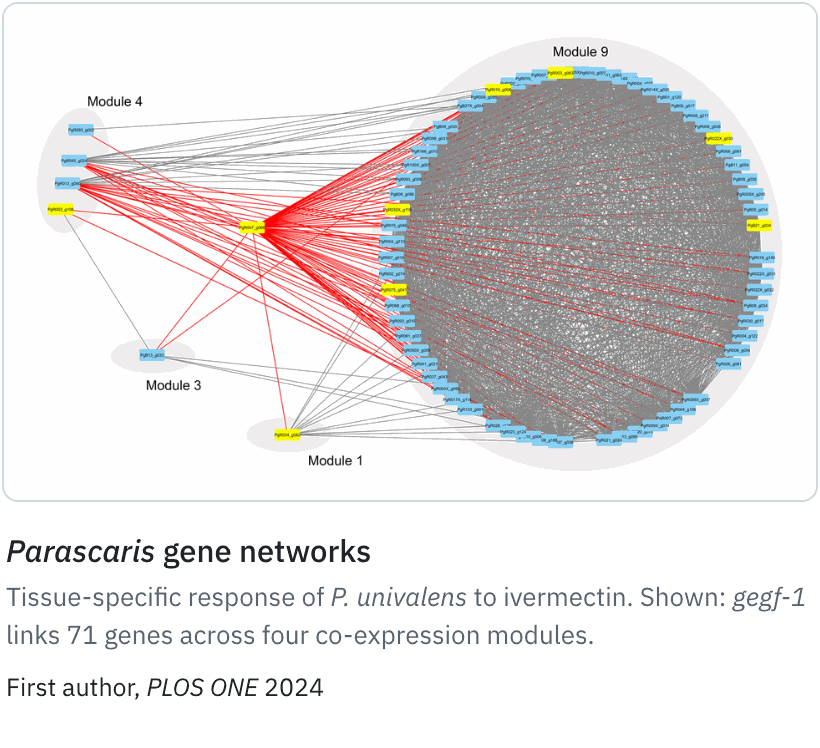
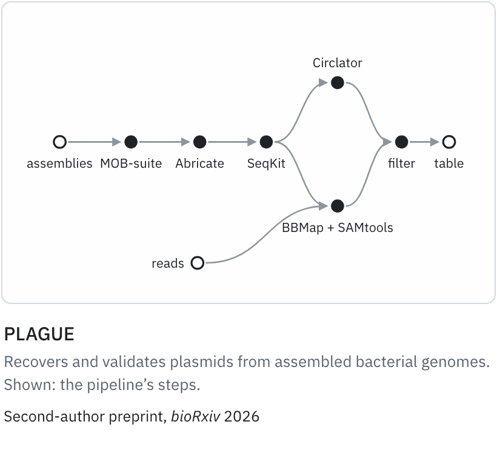
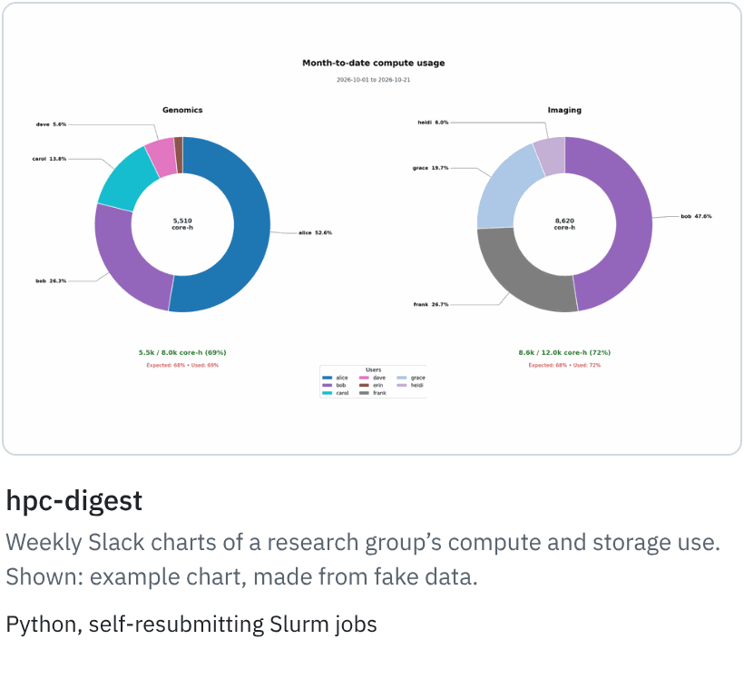

<picture>
  <source media="(prefers-color-scheme: dark)" srcset="assets/hero-dark.png">
  
</picture>

### Research

<a href="https://github.com/ruqse/vaginal_virbench"><picture><source media="(prefers-color-scheme: dark)" srcset="assets/plates/vaginal-virbench-dark.png"></picture></a> <a href="https://github.com/ruqse/mitch_manuscript"><picture><source media="(prefers-color-scheme: dark)" srcset="assets/plates/mitch-dark.png"></picture></a>
<a href="https://github.com/ruqse/pun-betatublin-BZ"><picture><source media="(prefers-color-scheme: dark)" srcset="assets/plates/parascaris-betatubulin-dark.png"></picture></a> <a href="https://github.com/ruqse/Parascaris-IVM-GeneNetwork"><picture><source media="(prefers-color-scheme: dark)" srcset="assets/plates/parascaris-networks-dark.png"></picture></a>

Papers: [Vaginal VirBench, *bioRxiv* 2026](https://doi.org/10.64898/2026.09.24.753817) · [MiTCH, *npj Women’s Health* 2026](https://doi.org/10.1038/s44294-026-00163-6) · [*Parascaris* gene networks, *PLOS ONE* 2024](https://doi.org/10.1371/journal.pone.0298039) · [PLAGUE, *bioRxiv* 2026](https://doi.org/10.64898/2026.07.10.737741)

- **[MetaPhlAn 4 vs VIRGO2](https://github.com/ruqse/metaphlan4-vs-virgo2-gardnerella)**: which *Gardnerella* species each reference database can report
- **[Ivermectin mappings](https://github.com/ruqse/MLgenePositions)**: Manhattan plots of *C. elegans* GWA mappings after ivermectin exposure

### Engineering

<a href="https://github.com/h-mel/plague"><picture><source media="(prefers-color-scheme: dark)" srcset="assets/plates/plague-dark.png"></picture></a> <a href="https://github.com/ruqse/hpc-digest"><picture><source media="(prefers-color-scheme: dark)" srcset="assets/plates/hpc-digest-dark.png"></picture></a>

- **[StagNF](https://github.com/ruqse/StagNF)**: metagenome quality control, host removal and taxonomic profiling in Nextflow
- **[*C. elegans* RNA-seq](https://github.com/ruqse/N2IVM)**: Nextflow workflow from raw reads to Salmon transcript abundances
- **[*C. elegans* Atlas](https://github.com/ruqse/c-elegans-atlas)**: interactive 3D explorer of worm anatomy, [live here](https://c-elegans-atlas.vercel.app/)
- **[PhDplanner](https://phdplanner.com)**: doctoral courses in Sweden, defence planning, and the [Sciframe](https://sciframe.phdplanner.com/) figure editor

Tools I use: Nextflow, Python, R, Bash, Slurm, Singularity, conda, React, three.js

### Get in touch

Always happy to talk microbiomes, reproducible workflows, or research tools. [LinkedIn](https://www.linkedin.com/in/farukdube)

